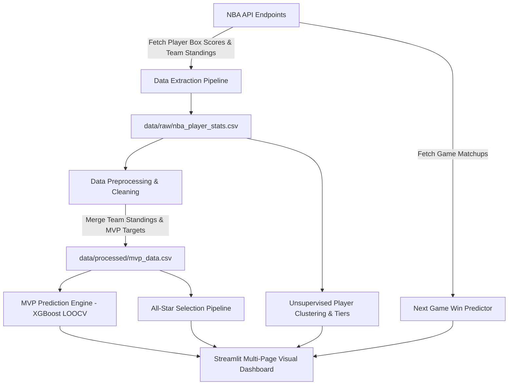

# 🏀 NBA Analytics & Machine Learning Project: Comprehensive Technical Documentation

An end-to-end data science, feature engineering, and predictive modeling system built around professional basketball statistics. This project ingests multi-decade player box scores and team standings from the official NBA API, applies advanced domain-informed data processing, trains machine learning models (XGBoost, K-Means), and serves predictive intelligence through an interactive **Streamlit** dashboard.

---

## 📐 System Architecture Overview



---

## 1. 📥 Data Extraction Phase

The data extraction layer interface directly with the official NBA stats database via the `nba_api` Python library.

### Key Scripts & Endpoints
- **[data_collection.py](src/data_collection.py)**: Orchestrates historical player stats extraction.
  - `leaguedashplayerstats.LeagueDashPlayerStats`: Extracts detailed per-season player data.
  - `measure_type_detailed_defense='Base'`: Collects traditional stats (Points, Rebounds, Assists, Steals, Blocks, Field Goal %, 3P %, Free Throw %).
  - `measure_type_detailed_defense='Advanced'`: Collects advanced efficiency metrics (True Shooting %, Usage %, Player Impact Estimate (PIE), Offensive/Defensive/Net Ratings, Assist/Rebound Percentages).
- **[build_mvp_dataset.py](src/data_pipeline/build_mvp_dataset.py)**: Enriches player stats with team context and target labels.
  - `leaguestandings.LeagueStandings`: Fetches team wins, losses, win percentages (`WinPCT`), and average point differentials (`DiffPointsPG`).
  - Target Labeling: Injects historical MVP winner annotations (`IS_MVP`) for every season from 2000-01 to 2025-26.

### Pipeline Controls & Rate Limiting
- Iterates across seasons defined in [config.yaml](config/config.yaml) (`2000-01` to `2025-26`).
- Enforces strict execution delays (`time.sleep(0.6)` and `time.sleep(1.2)`) between requests to respect NBA API rate limits.
- Merges base and advanced dataframes on (`PLAYER_ID`, `PLAYER_NAME`, `TEAM_ID`, `TEAM_ABBREVIATION`), dropping duplicate overlapping schema columns.
- **Counting stats are season totals** (`MIN`, `PTS`, `REB`, `AST`, `STL`, `BLK`, `TOV`), the API's default. `src/features.py::to_per_game` converts them wherever per-game values are needed (clustering, dashboard displays).
- **Franchise matching**: player stats use the team abbreviation of the time (`SEA`, `NJN`, `NOH`, `NOK`, `VAN`, `CHH`), while standings are keyed by current franchise. `src/nba_reference.py` maps each historical abbreviation to its franchise (e.g. `SEA` → `OKC`) before the merge, and the build fails if any player-season is left unmatched.

---

## 2. 🧹 Data Preprocessing & Domain Filtering

Raw sports statistical datasets are noisy—bench players appearing in only 2 games can skew statistical models. Domain-specific rules are applied to prune ineligible candidates.

### 1. Games Played & Noise Cutoffs
- **Raw Baseline**: Excludes players with `< 20` Games Played (`GP < 20`).
- **Clustering Pool**: Requires $\ge 15$ minutes per game and usage $\ge 12\%$.
- **MVP Candidate Pool**: Requires $\ge 50$ Games Played (`GP >= 50`).
- **All-Star Candidate Pool**: Requires $\ge 45$ Games Played (`GP >= 45`) and teams within top 10 conference seeds.

### 2. Domain Heuristic Filters ("The Westbrook Rule")
Found in [mvp_prediction.py](src/models/mvp_prediction.py#L8-L42):
- **Team Win Percentage Floor**: Candidates must belong to teams winning at least $55\%$ of games (`WinPCT >= 0.55`).
- **Mid-Seed Rule**: If a team's win percentage is between $55\%$ and $65\%$, the player must possess extraordinary individual output (`PIE >= 0.18` and `USG_PCT >= 0.28`) to remain an MVP candidate.
- **Role Player Rejection**: MVPs carry massive offensive responsibility. Candidates are filtered out if `USG_PCT < 18%`, `PIE < 12%`, or total points contribution `(PTS + AST * 2) < 1200`.

### 3. Dynamic Positional Mapping
Found in [all_star_prediction.py](src/models/all_star_prediction.py#L16-L34):
- Dynamically assigns positions (`Guard (G)`, `Forward (F)`, `Center (C)`) based on per-game assists, rebounds, and blocks ratios.
- Includes manual overrides for positional superstars (e.g., LeBron James, Nikola Jokić, Giannis Antetokounmpo, Kevin Durant, Stephen Curry).

---

## 3. 🧪 Feature Engineering

To evaluate players across changing basketball eras (e.g., pace inflation, 3-point revolution), features are standardized relative to each specific season.

### Era-Aware Feature Differentiation
Voting criteria changed significantly over time. The model adapts features depending on the era:
- **Hero Ball Era ($\le 2007$)**: Focuses on traditional volume statistics and overall win rank (`PTS_Z`, `REB_Z`, `AST_Z`, `WinPCT_Z`, `STOCKS_Z`, `SEED_RANK`, `IS_TOP_2_SEED`, `WON_LAST_YEAR`).
- **Analytics Era ($> 2007$)**: Focuses on advanced efficiency and net impact metrics (`TS_PCT_Z`, `OFFENSIVE_LOAD_Z`, `PIE_Z`, `ON_OFF_PROXY_Z`, `SEED_RANK`, `IS_TOP_2_SEED`, `DEF_RATING_Z`, `GP_Z`).

### Custom Formulated Metrics
1. **Total Offensive Load**:
   $$\text{OFFENSIVE\_LOAD} = \text{USG\_PCT} + \text{AST\_PCT}$$
   Quantifies the overall share of team offensive possessions terminated or assisted by the player.
2. **Defensive Impact ("Stocks")**:
   $$\text{STOCKS} = \text{STL} + \text{BLK}$$
3. **On/Off Impact Proxy**:
   $$\text{ON\_OFF\_PROXY} = \text{NET\_RATING} - \text{DiffPointsPG}$$
   Measures individual net rating performance relative to the team's baseline point differential.
4. **Voter Fatigue Index**:
   Flag column (`WON_LAST_YEAR`) that detects if a player won MVP in the preceding season, modeling historical voter reluctance toward 3-peats or back-to-back winners.
5. **Per-Season Z-Score Normalization**:
   For every feature $X$, normalizes stats relative to each season's mean $\mu$ and standard deviation $\sigma$:
   $$Z_{\text{season}} = \frac{X - \mu_{\text{season}}}{\sigma_{\text{season}}}$$
   *(Defensive ratings are inverted so lower rating yields a positive Z-score).*

---

## 4. 🤖 Machine Learning Models & Algorithms

### 1. 🏆 MVP Prediction Engine (`XGBClassifier` with LOOCV)
- **Source**: [mvp_prediction.py](src/models/mvp_prediction.py)
- **Algorithm**: Extreme Gradient Boosting (`XGBClassifier`) with hyperparameters `max_depth=3`, `learning_rate=0.1`, `n_estimators=100`.
- **Class Reweighting**: Sets `scale_pos_weight=50` to compensate for the extreme class imbalance (1 MVP vs. ~450 non-MVPs per season).
- **Validation Strategy**: **Leave-One-Season-Out Cross Validation (LOOCV)**. To predict season $S$, the model trains on all historical data outside $S$, preventing future bias / temporal leakage.
- **Accuracy**: Achieves **~73.1% historical accuracy** in identifying the exact #1 ranked MVP winner across 26 seasons.

### 2. 📊 Player Archetypes & K-Means Tiering
- **Source**: [player_clustering.py](src/models/player_clustering.py)
- **Archetype Assignment** (rule-based, not clustering): each player-season gets four composite scores from standardized per-game and rate stats (`Scorer`: PTS, USG_PCT, TS_PCT; `Playmaker`: AST, AST_PCT; `Rebounder`: REB, REB_PCT; `Defensive Player`: STL, BLK, inverted DEF_RATING). The highest score sets the archetype.
- **1D K-Means Tiering**: Fits a $K=3$ K-Means model on the composite archetype scores to categorize players into natural performance tiers: `Elite`, `Very Good`, and `Average`.

### 3. ⭐ All-Star Selection Engine
- **Source**: [all_star_prediction.py](src/models/all_star_prediction.py)
- **Impact Formula**:
  $$\text{Impact Score} = (\text{PIE} \times 100) + (\text{WinPCT} \times 30) + (\text{PTS} + 1.5 \times \text{AST} + 1.2 \times \text{REB}) + \left(\frac{\text{NET\_RATING}}{4}\right)$$
- PTS, AST and REB are per game. This is a hand-weighted formula, not a trained model.
- **Roster Selection Logic**: Ranks players within Eastern and Western conferences and selects 6 Guards, 6 Forwards, and 3 Centers per conference.

### 4. 🔮 Next Game Winner Predictor (`XGBClassifier`)
- **Source**: [next_game_prediction.py](src/models/next_game_prediction.py)
- **Algorithm**: `XGBClassifier` (`max_depth=4`, `learning_rate=0.1`, `eval_metric='logloss'`).
- **Features**: Season-to-date overall, home and road win % for both teams (computed only from games before the matchup), plus `WinPCT_Diff` and `HomeAway_Diff`.
- **Data**: Regular seasons 2020-21 to 2025-26 (configured in `config.yaml` under `next_game`). Games where either team has played fewer than 10 games are skipped.
- **Validation**: Time-based split, trained on earlier seasons and tested on the most recent full season. The deployed model is then refit on all seasons.
- **Model Storage**: Saved as binary model file at [next_game_model.pkl](saved_models/next_game_model.pkl).

---

## 5. 📊 Empirical Model Results & Performance Benchmarks

### 1. 🏆 MVP Model LOOCV Benchmark Results (2000-01 to 2025-26)
- **Overall Top-1 Rank Accuracy**: **19 / 26 seasons (73.1%)**
- **Hero Ball Era (2000-01 to 2007-08)**: **3 / 8 seasons (37.5%)**
- **Analytics Era (2008-09 to 2025-26)**: **16 / 18 seasons (88.9%)**
- **Domain Candidate Filtering**: Pruned 10,617 raw player-seasons down to 285 elite candidates.
- **Caveat**: the candidate filters and per-era feature sets were chosen while looking at these same LOOCV results, so the accuracy is likely optimistic for a genuinely new season.

#### Season-by-Season LOOCV Prediction Breakdown:

| Season | Model Predicted MVP | Actual Real-Life MVP | Result |
| :--- | :--- | :--- | :---: |
| **2000-01** | Shaquille O'Neal | Allen Iverson | ❌ |
| **2001-02** | Tim Duncan | Tim Duncan | ✅ |
| **2002-03** | Steve Nash | Tim Duncan | ❌ |
| **2003-04** | Kevin Garnett | Kevin Garnett | ✅ |
| **2004-05** | Amar'e Stoudemire | Steve Nash | ❌ |
| **2005-06** | Shawn Marion | Steve Nash | ❌ |
| **2006-07** | Steve Nash | Dirk Nowitzki | ❌ |
| **2007-08** | Kobe Bryant | Kobe Bryant | ✅ |
| **2008-09** | LeBron James | LeBron James | ✅ |
| **2009-10** | LeBron James | LeBron James | ✅ |
| **2010-11** | LeBron James | Derrick Rose | ❌ |
| **2011-12** | LeBron James | LeBron James | ✅ |
| **2012-13** | LeBron James | LeBron James | ✅ |
| **2013-14** | Kevin Durant | Kevin Durant | ✅ |
| **2014-15** | Stephen Curry | Stephen Curry | ✅ |
| **2015-16** | Stephen Curry | Stephen Curry | ✅ |
| **2016-17** | Russell Westbrook | Russell Westbrook | ✅ |
| **2017-18** | James Harden | James Harden | ✅ |
| **2018-19** | Giannis Antetokounmpo | Giannis Antetokounmpo | ✅ |
| **2019-20** | Giannis Antetokounmpo | Giannis Antetokounmpo | ✅ |
| **2020-21** | Giannis Antetokounmpo | Nikola Jokić | ❌ |
| **2021-22** | Nikola Jokić | Nikola Jokić | ✅ |
| **2022-23** | Joel Embiid | Joel Embiid | ✅ |
| **2023-24** | Nikola Jokić | Nikola Jokić | ✅ |
| **2024-25** | Shai Gilgeous-Alexander | Shai Gilgeous-Alexander | ✅ |
| **2025-26** | Shai Gilgeous-Alexander | Shai Gilgeous-Alexander | ✅ |

#### MVP Model Classification Report:
```
              precision    recall  f1-score   support

 Not MVP (0)       0.97      0.97      0.97       259
     MVP (1)       0.73      0.73      0.73        26

    accuracy                           0.95       285
   macro avg       0.85      0.85      0.85       285
weighted avg       0.95      0.95      0.95       285
```

---

### 2. 📊 Unsupervised Player Archetype & Tier Clustering Results
- **Dataset**: 7,474 qualifying player-seasons (≥ 20 games, ≥ 15 minutes per game, ≥ 12% usage).
- **Archetype & Tier Breakdown**:

| Archetype Cluster | Total Players | Elite Tier Count | Sample Elite Tier Players |
| :--- | :---: | :---: | :--- |
| **Scorer** | 1,639 | 286 | Joel Embiid, James Harden, Luka Dončić, Stephen Curry |
| **Playmaker** | 2,062 | 311 | Rajon Rondo, Chris Paul, Steve Nash, James Harden |
| **Rebounder** | 2,310 | 405 | Andre Drummond, DeAndre Jordan, Clint Capela, Kevin Love |
| **Defensive Player** | 1,463 | 207 | Ben Wallace, Andrei Kirilenko, Theo Ratliff, Gerald Wallace |

---

### 3. 🔮 Next Game Matchup Prediction Results
- **Held-out season**: 2025-26 (1,075 games after skipping each team's first 10 games). Trained on 2020-21 to 2024-25.

| Method | Accuracy |
| :--- | :---: |
| XGBoost model | **67.5%** |
| Always pick the home team | 54.9% |
| Pick the team with the better record | 68.1% |

The model clearly beats home-court alone but does **not** beat simply picking the better-record team; its features carry little information beyond that. Adding point differential, rest days or injury data would be the next step.

```
              precision    recall  f1-score   support

    Away Win (0)    0.66      0.58      0.62       485
    Home Win (1)    0.69      0.76      0.72       590

        accuracy                        0.68      1075
       macro avg    0.67      0.67      0.67      1075
    weighted avg    0.67      0.68      0.67      1075
```

---

## 6. 🖥️ Interactive Streamlit Dashboard

The web interface is located in [streamlit_app/](streamlit_app) and features 7 pages:

1. **Welcome Dashboard** ([app.py](streamlit_app/app.py)): Project landing page.
2. **Player Stats Analysis** ([1_🏀_Player_Stats.py](streamlit_app/pages/1_%F0%9F%8F%80_Player_Stats.py)): Per-game stats, percentile radar charts, and head-to-head player comparisons within an inferred position.
3. **Team Insights** ([2_📈_Team_Insights.py](streamlit_app/pages/2_%F0%9F%93%88_Team_Insights.py)): Franchise win % over time (relocated teams grouped with their current franchise), best/worst seasons, and championships.
4. **MVP Model Predictions** ([3_🤖_Model_Predictions.py](streamlit_app/pages/3_%F0%9F%A4%96_Model_Predictions.py)): Live single-season MVP prediction runner and full 26-season historical LOOCV accuracy breakdown.
5. **Player Clustering** ([4_📊_Player_Clusters.py](streamlit_app/pages/4_%F0%9F%93%8A_Player_Clusters.py)): Interactive playstyle archetype distribution and performance tier viewer.
6. **All-Star Selections** ([5_⭐_All_Star_Predictions.py](streamlit_app/pages/5_%E2%AD%90_All_Star_Predictions.py)): Displays predicted East & West All-Star rosters.
7. **Next Game Predictor** ([6_🔮_Next_Game_Prediction.py](streamlit_app/pages/6_%F0%9F%94%AE_Next_Game_Prediction.py)): Forecasts which team wins from season-to-date overall, home and road win percentages (adjustable with sliders).

---

## 7. 📁 Repository Directory Map

```
NBAAnalyticsProject/
├── config/
│   └── config.yaml                     # Pipeline parameters and target features
├── data/
│   ├── raw/
│   │   └── nba_player_stats.csv        # Consolidated raw multi-season player stats
│   └── processed/
│       ├── mvp_data.csv                # Merged player stats, standings & MVP labels
│       ├── all_stars_master.csv        # All-Star predicted master dataset
│       ├── clustered_players_master.csv # Master player cluster & tier dataset
│       └── game_matchups.csv           # Chronological game matchup tracking
├── saved_models/
│   └── next_game_model.pkl             # Serialized XGBoost model for game prediction
├── src/
│   ├── data_collection.py              # Ingests NBA API base & advanced stats
│   ├── pipeline.py                     # Rebuilds all datasets and models in order
│   ├── paths.py                        # Absolute paths to data, config and model files
│   ├── nba_reference.py                # MVP winners, champions, franchises, conferences
│   ├── features.py                     # Per-game conversion and position inference
│   ├── data_pipeline/
│   │   └── build_mvp_dataset.py        # Fetches standings & attaches MVP target labels
│   └── models/
│       ├── mvp_prediction.py           # XGBoost MVP model + LOOCV evaluation
│       ├── all_star_prediction.py      # All-Star selection algorithm
│       ├── player_clustering.py        # Archetype scoring & K-Means 1D tiering
│       └── next_game_prediction.py     # Team win predictor model training
├── streamlit_app/
│   ├── app.py                          # Streamlit entrypoint
│   ├── pages/                          # Interactive multi-page dashboard scripts
│   └── utils/data.py                   # Shared cached data loaders for the pages
└── requirements.txt                    # Project Python dependencies
```

---

## 8. 🚀 Execution Instructions

### 1. Installation
```bash
# Clone the repository
git clone https://github.com/tsetan13821/NBAAnalyticsProject.git
cd NBAAnalyticsProject

# Create and activate virtual environment
python -m venv venv
venv\Scripts\activate   # Windows

# Install dependencies
pip install -r requirements.txt
```

### 2. Run Data Ingestion & Model Pipelines
Run commands from the repository root as modules (`python -m ...`) so the `src` package imports resolve.
```bash
# Rebuild every dataset and model in order (uses the cached raw player stats)
python -m src.pipeline

# ...or also re-download raw player stats and game results from the NBA API
python -m src.pipeline --fetch

# Individual steps
python -m src.data_collection
python -m src.data_pipeline.build_mvp_dataset
python -m src.models.player_clustering
python -m src.models.all_star_prediction
python -m src.models.next_game_prediction [--refresh]
python -m src.models.mvp_prediction
```

### 3. Launch Interactive Streamlit Dashboard
```bash
streamlit run streamlit_app/app.py
```
