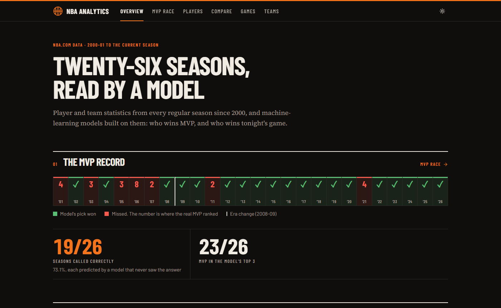
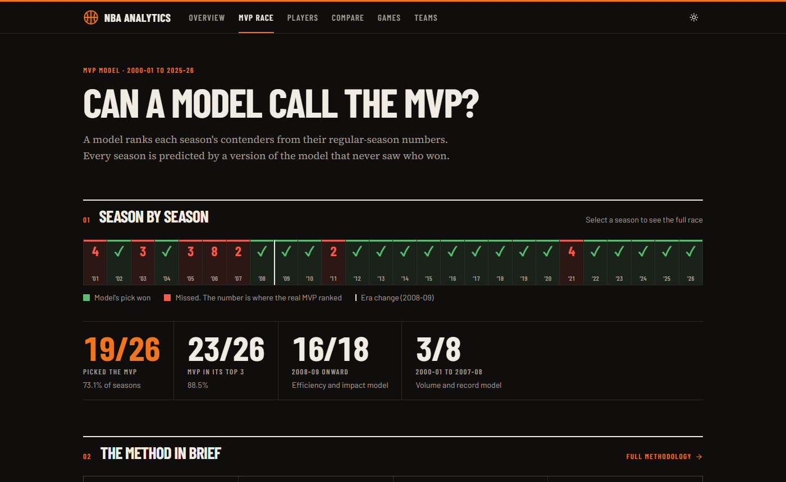
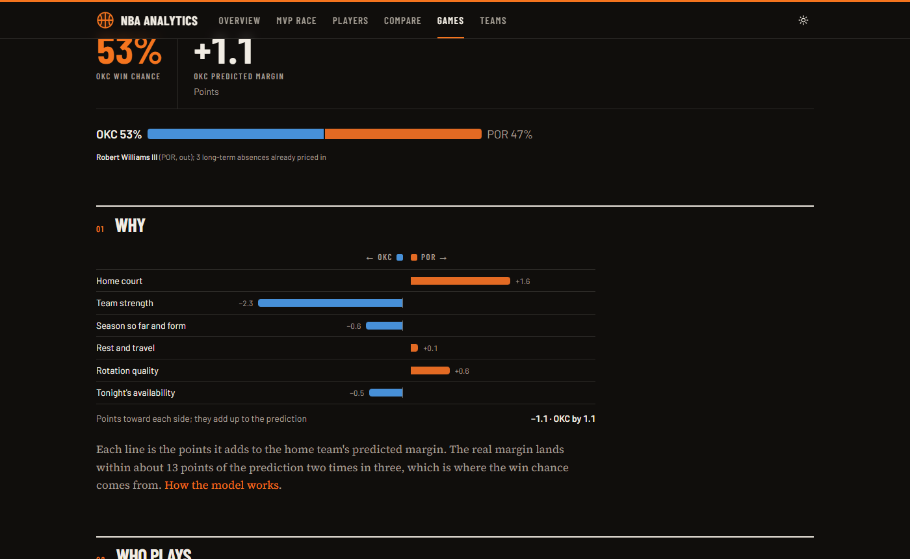
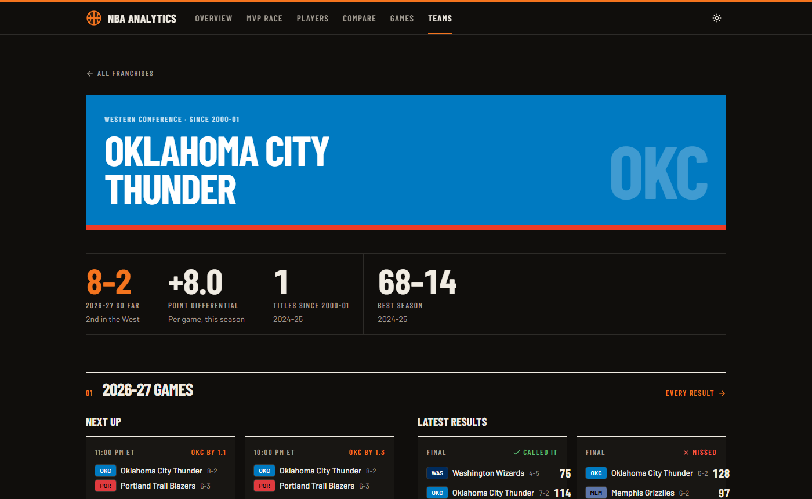
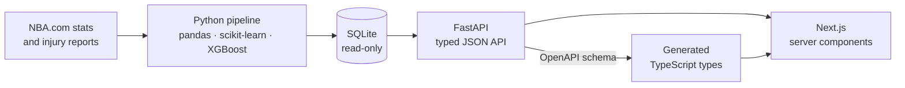

# NBA Analytics

[](https://github.com/tsetan13821/NBAAnalyticsProject/actions/workflows/tests.yml)
[](https://github.com/tsetan13821/NBAAnalyticsProject/actions/workflows/refresh-games.yml)


A full-stack NBA analytics site built on every regular season since 2000-01. It has two machine-learning models: one picks each season's MVP, the other predicts every game of the season in progress from the official injury report. Both are tested only on seasons they never saw.

The site is a **Next.js** front end on a typed, read-only **FastAPI** service. The API serves a SQLite database that an offline **Python** pipeline builds from NBA.com data. The game predictions refresh themselves through the day.



## What's on the site

| Page | What it shows |
| :--- | :--- |
| **MVP Race** | The model's pick against the real MVP for every season, and the full field of contenders. The model picked the actual MVP in **19 of 26 seasons**, and the winner was in its top 3 in 23. Each season was predicted by a model trained without it (leave-one-season-out). |
| **Players** | Search every player since 2000 by name, position, team and season. Each profile has season-by-season stats, a career chart, and the five most similar players by playing style. |
| **Compare** | Two to four players side by side in a season, each stat shown with its percentile among all players or the same position. |
| **Games** | The coming week's games: each team's win chance, the predicted margin, and who the injury report says may miss it. Each game shows what drives the prediction, and you can sit or play any player to see how it moves. |
| **Teams** | This season's standings, every champion since 2000-01, and a page per franchise with its record season by season, rosters, titles and career leaders. |

| | |
| :---: | :---: |
|  |  |
| MVP race | Why the model favours a team |
|  | |
| Franchise page | |

## The game predictor

It predicts the home team's margin with a ridge regression, then turns the margin into a win chance (a normal distribution whose spread is fitted to real results). Its inputs:

- **Team strength:** Elo ratings, net rating and recent form.
- **Schedule:** rest, back-to-backs, travel distance and time zones.
- **Player availability:** the official injury report, with each player weighted by what he is worth to his team. A fresh absence counts in full. A long one barely moves the line, because the team's recent results already reflect it.

Every input is computed walking through the games in date order, so a prediction only ever uses what was known before tip-off.

Results on 2025-26, a season it never saw (1,230 games):

| Model | Winners called | Log loss |
| :--- | ---: | ---: |
| **This model** | **69.4%** | **0.581** |
| Elo ratings alone | 67.6% | 0.607 |
| Team with the better record | 67.0% | — |
| Always the home team | 55.5% | — |

The site also checks its calibration (does a 70% favourite win about 7 times in 10?). It keeps a running record of how the predictions, made before each game, have fared this season.

## How it's built



- **Training and serving are separate.** pandas, scikit-learn and XGBoost run only offline. The API needs only FastAPI, Pydantic and Python's built-in `sqlite3`. The game model is linear, so the API re-adds its stored coefficients in pure Python to answer what-ifs; tests check it matches the pipeline.
- **One contract.** The API's OpenAPI schema is committed. The frontend's TypeScript types are generated from it, and CI fails if either drifts.
- **Read-only data.** Everything the site shows is precomputed into one SQLite file. That makes the API stateless and easy to run anywhere, and responses are safe to cache.
- **Tested.** About 280 tests in total, across the pipeline (data integrity, no look-ahead in the game model, the injury report parser), the API (endpoint behaviour against the real database) and the web app (components, URL state, chart options). GitHub Actions runs them, plus lint, type checks and a Docker Compose smoke test, on every pull request.

[docs/ARCHITECTURE.md](docs/ARCHITECTURE.md) covers the design in depth: data model, API, pages, decisions and roadmap. [PROJECT_DOCUMENTATION.md](PROJECT_DOCUMENTATION.md) covers the original data pipeline and MVP model.

## Keeping the predictions live

Results and injury reports change through the day, so the game data refreshes itself on two machines.

stats.nba.com, the source of results and the schedule, refuses cloud servers. The injury report PDFs are served from elsewhere and work from anywhere. So:

- **GitHub Actions** ([`refresh-games.yml`](.github/workflows/refresh-games.yml)) refreshes the injury report five times a day, from the morning to before the late tip-offs (US Eastern).
- **A scheduled task on a home PC** ([`scripts/install-refresh-task.ps1`](scripts/install-refresh-task.ps1)) refreshes everything, results included, three times a day. It works in its own clone of the repository, so it never touches work in progress. A run missed while the PC was off starts when it's back on.

Both run `python -m src.game_model.refresh --push`. It checks the serving database still builds, and commits only when results or injury statuses changed (a new timestamp alone isn't a change). If the other machine pushed first, it starts again from that commit instead of merging generated files. A host that deploys on push picks up each update.

To set up the home refresh on Windows (Python 3.11+, signed in to GitHub with git):

```powershell
powershell -ExecutionPolicy Bypass -File .\scripts\install-refresh-task.ps1
# Times are on this PC's clock; change them with -Times '20:00', '00:00', '05:00'
# Remove it with -Remove
```

Things to know:

- GitHub can start scheduled runs late, so the site is fresh to within a few hours, not minutes.
- Scheduled workflows run only from the default branch, and GitHub turns them off after 60 days without activity in the repository.
- Pull before pushing to `main`, since both refreshes commit there.
- Re-run the installer after `requirements.txt` changes. The task's log is `data\cache\refresh.log` in its clone (`%LOCALAPPDATA%\NBAAnalyticsRefresh\repo`).

## Run it locally

### With Docker (easiest)

```bash
git clone https://github.com/tsetan13821/NBAAnalyticsProject.git
cd NBAAnalyticsProject
docker compose up --build
```

Then open the web app at http://localhost:3000, or the interactive API docs at http://localhost:8000/docs. The API image builds the database itself. If a port is taken, choose others: `WEB_PORT=3001 API_PORT=8001 docker compose up --build`.

### Without Docker

You need Python 3.11+ and Node.js 24. The processed data and models are committed, so you don't need to download anything.

```bash
python -m venv .venv
.venv\Scripts\activate          # macOS/Linux: source .venv/bin/activate
pip install -r requirements.txt
python -m src.export_db         # builds backend/data/nba.db

# The API, from backend/
cd backend
pip install -r requirements.txt
uvicorn app.main:app --reload   # http://localhost:8000/docs

# The web app, from frontend/ (in a second terminal)
cd frontend
npm install
npm run dev                     # http://localhost:3000
```

The web app finds the API through `API_URL` (default `http://localhost:8000`). Copy `frontend/.env.example` to `frontend/.env.local` to change it.

### Refreshing the data

```bash
python -m src.game_model.live           # latest results, schedule and injury report; re-predict the season
python -m src.data_pipeline.fetch_current_season   # the season in progress: player stats and standings
python -m src.data_pipeline.fetch_player_bio       # current rosters
python -m src.export_db                 # then rebuild the database

python -m src.pipeline                  # rebuild every dataset and model from the cached data
python -m src.pipeline --fetch          # ... downloading everything from NBA.com again first
```

### Tests

```bash
pip install -r requirements-dev.txt
pytest                                  # pipeline and models

cd backend                              # API (needs the database)
pip install -r requirements-dev.txt
ruff check . && pytest

cd ../frontend                          # web app
npm run typecheck && npm run lint && npm test
```

If you change the API on purpose, regenerate its committed schema with `python -m scripts.export_openapi` (from `backend/`). Then regenerate the frontend's types with `npm run gen:api` (from `frontend/`).

## Repository layout

```
├── src/                  # Offline pipeline
│   ├── pipeline.py       #   rebuilds every dataset and model in order
│   ├── data_pipeline/    #   NBA.com downloads: season stats, standings, rosters
│   ├── models/           #   MVP model, player archetypes, All-Star picks, the v1 next-game model
│   ├── game_model/       #   game predictor: game logs, injury reports, player value, training, live refresh
│   └── export_db.py      #   builds the read-only SQLite database the API serves
├── backend/              # FastAPI service: routers, schemas, repositories, tests, openapi.json
├── frontend/             # Next.js app: routes in src/app, components, generated API types
├── scripts/              # The home PC's scheduled refresh (Windows), and research scripts
├── data/                 # Raw and processed datasets (committed)
├── saved_models/         # Trained models and their metrics
├── tests/                # Pipeline tests
├── docs/                 # Architecture and screenshots
├── streamlit_app/        # The original Streamlit dashboard (v1)
└── docker-compose.yml    # The API and web app together
```

## The original dashboard

The project started as a Streamlit dashboard, which is still in `streamlit_app/`: `streamlit run streamlit_app/app.py`. It also has the player-archetype clusters and the All-Star roster picks, which the new site doesn't show yet.

## Data

Regular-season data from NBA.com, from 2000-01 to the season in progress. This is an independent project, not affiliated with or endorsed by the NBA.

## License

See [LICENSE](LICENSE).
