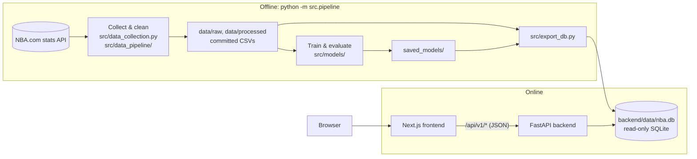

# Architecture

NBA Analytics is moving from a single Streamlit app (v1) to a full-stack application (v2): an offline data pipeline, a read-only REST API, and a web frontend. This document describes the target design, the data model, and the reasoning behind the main decisions.

## Overview



| Layer | Technology | Responsibility |
| :--- | :--- | :--- |
| Pipeline | Python, pandas, scikit-learn, XGBoost, `nba_api`, pdfplumber | Fetch data and injury reports, clean them, train and evaluate models, export serving artifacts |
| Serving data | SQLite (`nba.db`) | Everything the API needs, precomputed, including the game model's coefficients |
| Backend | FastAPI, Pydantic | Typed, read-only JSON API; what-if game predictions |
| Frontend | Next.js, TypeScript, Tailwind CSS, shadcn/ui, ECharts | Pages and interactive charts; API types generated from the OpenAPI schema |

Hosting is deliberately undecided. Everything is configured through environment variables and runs in Docker, so the same build can move between hosts.

## Design principles

1. **Precompute everything that doesn't depend on user input.** MVP predictions, percentiles and similar players change only when the pipeline reruns, so they are computed once at build time instead of on every request.
2. **Keep training and serving dependencies separate.** pandas, scikit-learn and XGBoost run only offline. The API needs only FastAPI, Pydantic and Python's built-in `sqlite3`. The game model is linear, so the API re-adds its coefficients (stored in the database) in pure Python to answer what-ifs; tests check the API reproduces the pipeline's predictions.
3. **Fail at build time, not at request time.** The database schema (`src/db_schema.sql`) declares primary keys, foreign keys and `CHECK` constraints. The export validates every foreign key and writes to a temporary file, so a broken build never replaces a working database.
4. **One contract between frontend and backend.** Pydantic schemas generate the OpenAPI document, and the frontend's TypeScript types are generated from it. A breaking API change shows up as a type error in CI.

## Data model

Built by `python -m src.export_db` (about 14 MB). Columns ending in `_pg` are per-game averages; `*_pct` columns are fractions.

| Table | Rows (approx.) | Contents |
| :--- | ---: | :--- |
| `franchises` | 30 | Current team abbreviation, NBA team ID (for logos), name, conference, brand colors |
| `players` | 2,100 | Name, search key (lowercase, no accents), official listed position and G/F/C group, height, weight, country, college, draft details, team in the last season of stats, current team |
| `seasons` | 27 | 2000-01 to 2025-26 with champion and MVP, plus the season in progress (`in_progress = 1`) |
| `team_seasons` | 806 | Record, win %, point differential, conference rank, championship flag (standings so far for the season in progress) |
| `player_seasons` | 11,100 | Per-game and advanced stats, archetype, tier and archetype scores |
| `player_percentiles` | 21,000 | Percentile of each stat among all players and within the player's position group, per season |
| `similar_players` | 37,000 | Five most similar player-seasons (same season) by archetype-score distance |
| `mvp_candidates` | 285 | Leave-one-season-out model score and rank for every MVP candidate |
| `mvp_seasons` | 26 | Predicted vs actual MVP per season, era, where the real MVP ranked |
| `team_game_log` | 14,500 | Each team's game-by-game results and running record (2020-21 onward) |
| `game_predictions` | 1,230 a season | The season in progress: every game played so far (as predicted before it) and the coming week, with the model's inputs as JSON |
| `game_players` | 30 per game | Every rostered player in those games: value, usual minutes, injury status, reason and chance of playing |
| `meta` | — | Build time, first and last completed season, the season in progress and when it was fetched, the MVP model's record, the game model (coefficients, spread, play rates), its evaluation and live status, date the rosters were read |

**The season in progress.** The models need finished seasons with known winners, so they only ever see the completed seasons in `config.yaml` (`start_season` to `end_season`). The season under way (`current_season`) is fetched separately by `src/data_pipeline/fetch_current_season.py` into `data/raw/current_season_*.csv`: every player who has played at least one game (the usual 20-game minimum would leave nobody early on) and the standings so far. `export_db` merges it into the player and team tables and marks it `in_progress`; it gets no MVP predictions, archetypes or similar players. The API returns `in_progress` on every season it reports, and `meta.last_season` stays the last completed season. Re-run the script, then `python -m src.export_db`, to bring it up to date. When the season ends, move it to `end_season`, set the next one as `current_season`, and rerun `python -m src.pipeline --fetch`.

**Current team vs last team.** Players move between seasons and during them, so the team in a player's newest season of stats isn't always the team they're on now. `latest_team_abbr` is the player's team in their last season of stats; `current_team_abbr` is the team NBA.com lists them on today (NULL for retired players and free agents), read by `src/data_pipeline/fetch_player_bio.py` along with the bio data. The site shows the current team with the date the rosters were read (`rosters_as_of`), and notes when it differs from the team in the stats. Re-run that script, then `python -m src.export_db`, to pick up trades and signings.

Relocated teams (for example the Seattle SuperSonics) are stored under their current franchise (`OKC`), with the abbreviation of the time kept in `team_abbr_then`.

## Game predictor

`src/game_model/` predicts every game of the season in progress: the home team's margin and win chance, from team strength, form, rest and travel, and the official injury report, with each player weighted by what he is worth to his team.

| Module | Writes | What it does |
| :--- | :--- | :--- |
| `fetch_games` | `data/raw/games/{team,player}_games_<season>.csv.gz` | Team and player game logs from NBA.com (2015-16 onward for teams, 2017-18 for players) |
| `schedule` | `data/raw/games/schedule_<season>.csv` | The season's schedule, for upcoming games |
| `injury_reports` | `data/raw/injuries/injuries_<season>.csv.gz` | The league's injury report PDFs (2019-20 onward), parsed with pdfplumber and matched to player ids; the PDFs are cached in `data/cache/` and not committed |
| `games` | — | Elo ratings, net rating, form, rest, back-to-backs, travel and time zones before every game |
| `availability` | — | Player value (Game Score per minute above replacement, times usual minutes) and how much of it each team fields: at full strength, lately, and expected tonight |
| `features`, `train` | `saved_models/game_model.json`, `game_model_metrics.json` | Ridge regression on the margin; held-out season, walk-forward, baselines, ablation and calibration |
| `live` | `data/processed/game_predictions.csv`, `game_players.csv`, `live_meta.json` | The season in progress, from the latest results and injury report, through the same code as training |
| `refresh` | — | Runs `live` and publishes the data to `main` (the scheduled refreshes) |

Every input is computed walking through the games in date order, so a prediction only ever uses what was known before tip-off; upcoming games go through the same code with no result. The model's injury input is the player value a team expects to field tonight minus what it has fielded in its last ten games, so a long absence (already in the team's results) barely moves the line and a fresh one counts in full. The chance of playing for each report status is measured on rotation players in the training seasons.

**Refreshing.** Results and the injury report change through the day. `python -m src.game_model.live` downloads the latest games, schedule and report and re-predicts the season; `python -m src.export_db` then rebuilds the database. `--no-fetch` reuses what is on disk without touching the network. A download that fails is reported (and listed under `fetch_failed` in `live_meta.json`), and the run carries on with the files on disk.

The refresh runs on two machines, because stats.nba.com (results and the schedule) refuses cloud servers while the injury reports, served from elsewhere, don't:

- **GitHub Actions** (`.github/workflows/refresh-games.yml`), five times a day from the morning to before the late tip-offs (US Eastern): the injury report only (`--injuries-only`). The PDFs are kept between runs with `actions/cache`.
- **A scheduled task on a home PC** (`scripts/install-refresh-task.ps1`), three times a day after the games: everything, results included. It works in its own clone of the repository, so it never commits on the branch being worked on, and a run missed while the PC was off starts when it is back on. Its log is `data/cache/refresh.log` in that clone.

Both run `python -m src.game_model.refresh --push`, which:

- refreshes the data and checks the serving database still builds;
- commits only if results or statuses changed, with `[skip ci]`; the timestamp alone isn't enough, and gzip files are written with a fixed header time so unchanged data gives the same bytes;
- pushes to `main`, where a host that deploys on push picks it up.

When both machines push at about the same time, the later push is rejected. That run then starts again from the other's commit instead of merging generated files line by line. GitHub can start scheduled runs late, so the site is fresh to within a few hours, not minutes. A worker beside the API, writing to a separate live database, would close that gap; it depends on where the site is hosted.

Injury statuses are decided per team. Reports come every 15 minutes in 2026-27. Where the latest report lists the team for that game, its statuses are used. Otherwise the Out and Doubtful players from the team's most recent listing are carried forward. This covers games beyond the latest report, and teams whose entry still reads NOT YET SUBMITTED. A team with nobody injured isn't in the report at all, so nothing is carried if it has played since its last listing.

## Backend API

The API lives in `backend/`. Interactive documentation is served at `/docs`, and the full schema is committed as [`backend/openapi.json`](../backend/openapi.json). Every endpoint is a read-only `GET`.

| Endpoint | Purpose |
| :--- | :--- |
| `GET /api/v1/meta` | Season range, build time and headline model metrics |
| `GET /api/v1/seasons` | Every season with its champion and MVP |
| `GET /api/v1/health` | Health check (database schema version, build time) |
| `GET /api/v1/players?q=&position_group=&season=&team=&limit=&offset=` | Paginated player search; ignores accents and case |
| `GET /api/v1/players/{id}` | Profile: bio, current team, career averages, season-by-season stats, MVP seasons |
| `GET /api/v1/players/{id}/similar?season=` | Five most similar players in a season |
| `GET /api/v1/players/compare?ids=&ids=&season=&peer_group=ALL\|POSITION` | Stats and percentiles for 2 to 4 players |
| `GET /api/v1/mvp` | Model accuracy overall, by era and per season |
| `GET /api/v1/mvp/{season}?limit=` | MVP race: ranked candidates with scores and stats |
| `GET /api/v1/teams` | All 30 franchises with their latest record |
| `GET /api/v1/teams/{abbr}` | Franchise history and championships |
| `GET /api/v1/teams/{abbr}/roster?season=` | Players on a team in a season |
| `GET /api/v1/teams/{abbr}/form?season=` | Game-by-game record and running win % (2020-21 onward) |
| `GET /api/v1/games/upcoming` | Predictions for the coming week, with key absences and the injury report's time |
| `GET /api/v1/games/results?team=&limit=&offset=` | Games played this season as predicted beforehand, newest first, with the track record (accuracy, log loss, confidence bins) |
| `GET /api/v1/games/{game_id}?out=&in=` | One game: prediction, its breakdown in points per input group, and both rosters; `out`/`in` force players out of or into the game (what-if) |
| `GET /api/v1/games/model` | The game model's inputs and weights, injury play rates, and its full evaluation |

### Code layout

```
backend/app/
├── main.py          # App factory: lifespan checks, CORS, cache headers, routers
├── config.py        # Settings from environment variables
├── db.py            # Read-only SQLite connection per request, schema version check
├── routers/         # HTTP layer: parameters, validation, status codes
├── services/        # Logic beyond a query: player comparison, game what-ifs, track record
├── repositories/    # Parameterized SQL, returns plain dicts
└── schemas/         # Pydantic response and request models (generate the OpenAPI schema)
```

### Behaviour

- **Startup checks.** The app refuses to start if the database is missing or was built with a different schema version, or if the game model stored in it can't be loaded.
- **Read-only access.** Each request opens the database with `mode=ro&immutable=1`, so the API can never write to it, and SQLite skips locking.
- **Caching.** Successful `GET` responses send `Cache-Control: public, max-age=…` because the data changes only when the pipeline reruns. Errors and the health check send `no-store`. What-ifs are `GET`s too, so each combination is cacheable.
- **Errors.** Unknown resources return `404` with `{"detail": "..."}`; malformed input returns FastAPI's standard `422` body; a what-if naming a player who isn't in the game, or the same player both out and in, returns `400`.

### Configuration

| Variable | Default | Purpose |
| :--- | :--- | :--- |
| `NBA_DB_PATH` | `backend/data/nba.db` | Serving database |
| `NBA_ALLOWED_ORIGINS` | `http://localhost:3000` | Comma-separated CORS origins (the frontend) |
| `NBA_CACHE_MAX_AGE` | `3600` | Seconds clients may cache `GET` responses |
| `PORT` | `8000` | Port inside the Docker image |

### Docker

`backend/Dockerfile` has two stages. The first installs the pipeline requirements and runs `python -m src.export_db` on the committed data. The second starts from a clean `python:3.11-slim`, installs only FastAPI, Pydantic and Uvicorn, and copies in the app and the built database. Training libraries never reach the runtime image. The container runs as a non-root user and has a health check.

## Frontend

The web app lives in `frontend/`: Next.js 16 (App Router, React Server Components), TypeScript, Tailwind CSS 4, shadcn/ui on Base UI, and ECharts.

| Route | Page |
| :--- | :--- |
| `/` | Overview: the MVP model's season-by-season record, the game model against its baselines and its record this season, and a contents list |
| `/mvp` | MVP model accuracy overall and by era, a strip of every season (hit or miss), the method in brief, and a ledger of every pick against the real winner |
| `/mvp/method` | How the MVP model works: the candidate rules (with a funnel of how many player-seasons each removes), the features, the two eras, model settings, validation, results and limitations, with the reasoning behind each decision |
| `/mvp/{season}` | One season's race: model pick vs actual MVP side by side, a chart of each candidate's share of the model score, full candidate table, season picker |
| `/players` | Player search: by name (as you type, ignoring accents), position, team and season; 25 per page. The filters live in the URL, so a search can be shared or bookmarked |
| `/players/{id}` | Player profile: bio, MVP seasons, career averages, a chart of any stat by season, the season-by-season table with career bests marked, and the five most similar players in a chosen season (`?season=`) |
| `/games` | The coming week's games grouped by day: each team's chance, the predicted margin and key absences; then the season so far (winners called, how often favourites won at each level of confidence, latest results) |
| `/games/{id}` | One game: win chance, predicted margin, the margin broken down by input group (a diverging bar chart, away left and home right), and both rosters with value, minutes, injury status and chance of playing. Upcoming games have Report / Sits / Plays controls for each player; the choices live in the URL (`?out=1629029&in=203999`) |
| `/games/results` | Every game played this season with the prediction and final score, filterable by team, 24 per page |
| `/games/method` | How the game predictor works: team strength, player value, the injury report, the model and its weights, held-out, walk-forward, ablation and calibration results, and limitations |
| `/compare` | Two to four players side by side in a season they all played: every stat with its percentile (against all players or the same position), grouped into scoring, playmaking, rebounding and defence, and overall impact, with the leader in each row and a count of categories led. The comparison appears when Compare is pressed and hides again when the lineup changes. The lineup, season, peer group and whether the comparison is shown live in the URL (`?ids=2544,201939&season=2015-16&peers=position&show=1`), so shared links open straight on the comparison; each open slot in the lineup opens a picker: a search box plus suggestions (the player's closest matches, or the top of last season's MVP race) |

### Code layout

```
frontend/src/
├── app/                 # Routes (page.tsx per route), root layout, error and not-found pages
├── components/
│   ├── ui/              # shadcn/ui primitives (card, table, select, ...)
│   ├── charts/          # ECharts wrapper and chart components (client-side)
│   ├── mvp/             # MVP page components (season strip, ledger, funnel, validation diagram, ...)
│   ├── players/         # Player search and profile components
│   ├── compare/         # Compare page: lineup cards, add-player slots and picker, comparison table
│   ├── games/           # Game predictor: chance bar, game card, margin breakdown, rosters with what-if controls
│   └── editorial.tsx    # Shared layout pieces: numbered sections, big figures, decision notes
├── content/
│   └── mvp-method.ts    # Facts about the MVP model shown on /mvp/method (rules, funnel counts, features, settings)
└── lib/
    ├── api/client.ts    # Typed, cached API access (server-side only)
    ├── api/schema.ts    # Generated from backend/openapi.json (npm run gen:api)
    ├── format.ts        # Number, season and name formatting
    ├── player-search.ts # /players URL <-> API query mapping (invalid values are dropped, not sent)
    ├── compare.ts       # /compare URL <-> state, metric groups, category leaders
    ├── games.ts         # /games/{id} what-if URL <-> state, prediction wording
    └── theme.ts         # Dark/light theme without a flash on load
```

### Data fetching

- **One typed contract.** `npm run gen:api` turns `backend/openapi.json` into TypeScript types, and `openapi-fetch` uses them, so paths, parameters and response fields are all checked at compile time. CI regenerates the types and fails if they differ from the committed file.
- **Server-side only.** Pages are React Server Components that call the API from the Next.js server through `API_URL`. The browser never talks to the API directly, so no API URL or CORS setup reaches the client.
- **Fetched at request time, cached for an hour.** With Next.js Cache Components, every page is a prerendered static shell (layout, headings, skeletons) and the data streams in. Each API getter awaits `connection()` and then calls a `"use cache"` function with `cacheLife("hours")`. The result:
  - `next build` never needs the API running, so CI and the Docker image build the frontend on their own.
  - Repeat visits are served from the cache.
- **Search.** The player search is a plain GET form, so it works before JavaScript loads. Once it has, results update after a short pause in typing (replacing the history entry) or as soon as a filter changes (adding one, so Back undoes it).
- **Errors.** If the API is unreachable, the error boundary shows a retry page. An unknown season or player renders the not-found page with a `noindex` tag. The HTTP status stays 200, because the status line is sent with the static shell before the season is checked. This is a known trade-off of streaming.

### Design

- **Look.** The site is laid out like a sports almanac rather than a dashboard: numbered sections under heavy rules, large condensed headlines and scoreboard figures, hairline tables, and serif body text for the long-form explanations. Fonts are Barlow (interface), Barlow Condensed (headlines and figures) and Source Serif 4 (prose), self-hosted through `next/font`. Corners are nearly square and there are no card shadows.
- **Theme.** Dark ("arena", warm near-black) is the default, and the light theme ("newsprint", warm off-white) is a toggle. Both are CSS variables in `globals.css`. Orange (`--brand`) marks the real MVP and active elements; green and red (`--hit`, `--miss`) mark correct and incorrect picks. A small inline script applies the saved theme before the first paint, so there is no flash on load.
- **Charts** are ECharts with only the bar chart, grid and tooltip modules registered, and they render as SVG. Colours and the font are read from the same CSS variables. They are converted to RGB first, because ECharts can't parse `oklch()`.
- **Headshots** come from the NBA CDN through the Next.js image optimizer. Players without a photo fall back to their initials.
- **Small diagrams** (the season strip, the candidate funnel, the validation diagram) are plain HTML and CSS rather than chart components, so they render on the server with no JavaScript.
- **Teams** are shown as an abbreviation badge in the team's colour (text colour chosen for contrast) rather than hotlinked logos.

## Testing and CI

- **Pipeline:** unit tests for helpers, integrity checks on the committed datasets, model regression guards (MVP accuracy, tier ordering, no look-ahead in game features).
- **Game model:** the injury report parser (names, wrapped reasons, tip times), Elo and team state without look-ahead, player value and best-first minutes, availability (fresh vs long injuries, benched players, returning stars), features, win probability and calibration.
- **Export:** builds the database in a temp folder and checks foreign keys, MVP consistency, percentile bounds, game-log records against standings, that stored game predictions follow from their inputs, and that the stored players add up to each team's expected value (what the API's what-ifs rely on).
- **Backend:** endpoint tests with FastAPI's `TestClient` against the real database, covering:
  - search relevance, accent handling and pagination
  - 404 and 422 cases
  - game predictions: list and detail agree, the breakdown sums to the margin, sitting a star lowers his team's chance, what-if validation
  - cache and CORS headers
  - a snapshot test that fails if the API schema changes without `backend/openapi.json` being regenerated
- **Frontend:** type checking, ESLint, and Vitest + Testing Library tests for:
  - formatting helpers and colour contrast
  - navigation state
  - the game predictor's what-if URL state and wording
  - the MVP components and the chart option builder

  End-to-end tests (Playwright) are planned for phase 4.

GitHub Actions runs four jobs on every push to `main` and every pull request:
1. pipeline tests
2. API lint (ruff) and tests, after building the database
3. web: a check that the generated API types are current, then type check, lint, unit tests and a production build
4. Docker Compose: builds both images, waits for their health checks, and checks a page renders with real data

## Roadmap

| Phase | Scope | Status |
| :--- | :--- | :--- |
| 0. Foundations | Serving database export, official player bio data, this document | Done |
| 1. Backend API | FastAPI app, endpoints above, tests, Dockerfile | Done |
| 2. Frontend foundation | Next.js app, design system, typed API client, MVP Race page | Done |
| 3. Core pages | Home, player search/profile/compare, game predictor, franchise pages | In progress (search, profile, compare and game predictor done) |
| 4. Ship | Hosting, end-to-end tests, README with screenshots; retire the Streamlit app | Planned |
| 5. Extensions | Archetype and All-Star pages, Basketball Reference data (MVP vote shares, real All-Star rosters) | Later |
