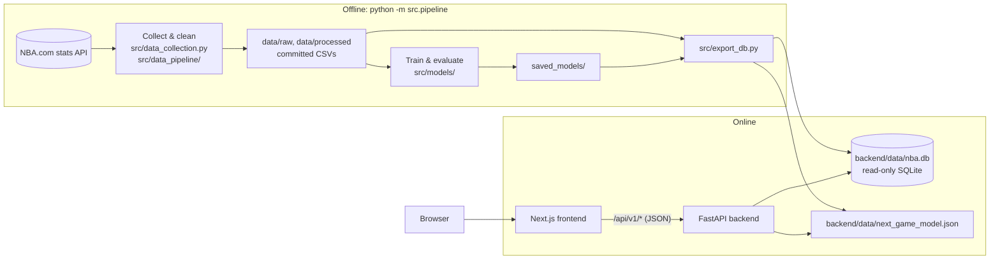

# Architecture

NBA Analytics is moving from a single Streamlit app (v1) to a full-stack application (v2): an offline data pipeline, a read-only REST API, and a web frontend. This document describes the target design, the data model, and the reasoning behind the main decisions.

## Overview



| Layer | Technology | Responsibility |
| :--- | :--- | :--- |
| Pipeline | Python, pandas, scikit-learn, XGBoost, `nba_api` | Fetch data, clean it, train and evaluate models, export serving artifacts |
| Serving data | SQLite (`nba.db`), JSON model file | Everything the API needs, precomputed |
| Backend | FastAPI, Pydantic | Typed, read-only JSON API; live next-game predictions |
| Frontend | Next.js, TypeScript, Tailwind CSS, shadcn/ui, ECharts | Pages and interactive charts; API types generated from the OpenAPI schema |

Hosting is deliberately undecided. Everything is configured through environment variables and runs in Docker, so the same build can move between hosts.

## Design principles

1. **Precompute everything that doesn't depend on user input.** MVP predictions, percentiles and similar players change only when the pipeline reruns, so they are computed once at build time instead of on every request.
2. **Keep training and serving dependencies separate.** pandas, scikit-learn and XGBoost run only offline. The API needs only FastAPI, Pydantic and Python's built-in `sqlite3`. The XGBoost model is exported as plain JSON trees and evaluated in pure Python, which keeps the deployed bundle small and starts quickly. A test checks the export matches XGBoost's predictions.
3. **Fail at build time, not at request time.** The database schema (`src/db_schema.sql`) declares primary keys, foreign keys and `CHECK` constraints. The export validates every foreign key and writes to a temporary file, so a broken build never replaces a working database.
4. **One contract between frontend and backend.** Pydantic schemas generate the OpenAPI document, and the frontend's TypeScript types are generated from it. A breaking API change shows up as a type error in CI.

## Data model

Built by `python -m src.export_db` (about 12 MB). Columns ending in `_pg` are per-game averages; `*_pct` columns are fractions.

| Table | Rows (approx.) | Contents |
| :--- | ---: | :--- |
| `franchises` | 30 | Current team abbreviation, NBA team ID (for logos), name, conference, brand colors |
| `players` | 2,100 | Name, search key (lowercase, no accents), official listed position and G/F/C group, height, weight, country, college, draft details, team in the last season of stats, current team |
| `seasons` | 27 | 2000-01 to 2025-26 with champion and MVP, plus the season in progress (`in_progress = 1`) |
| `team_seasons` | 806 | Record, win %, point differential, conference rank, championship flag (standings so far for the season in progress) |
| `player_seasons` | 11,100 | Per-game and advanced stats, archetype, tier and archetype scores |
| `player_percentiles` | 21,000 | Percentile of each stat among all players and within the player's position group, per season |
| `similar_players` | 37,000 | Five most similar player-seasons (same season) by archetype-score distance |
| `mvp_candidates` | 285 | Leave-one-season-out model score and rank for every MVP candidate |
| `mvp_seasons` | 26 | Predicted vs actual MVP per season, era, where the real MVP ranked |
| `team_game_log` | 14,500 | Each team's game-by-game results and running record (2020-21 onward) |
| `meta` | — | Build time, first and last completed season, the season in progress and when it was fetched, headline model metrics, date the rosters were read |

**The season in progress.** The models need finished seasons with known winners, so they only ever see the completed seasons in `config.yaml` (`start_season` to `end_season`). The season under way (`current_season`) is fetched separately by `src/data_pipeline/fetch_current_season.py` into `data/raw/current_season_*.csv`: every player who has played at least one game (the usual 20-game minimum would leave nobody early on) and the standings so far. `export_db` merges it into the player and team tables and marks it `in_progress`; it gets no MVP predictions, archetypes or similar players. The API returns `in_progress` on every season it reports, and `meta.last_season` stays the last completed season. Re-run the script, then `python -m src.export_db`, to bring it up to date. When the season ends, move it to `end_season`, set the next one as `current_season`, and rerun `python -m src.pipeline --fetch`.

**Current team vs last team.** Players move between seasons and during them, so the team in a player's newest season of stats isn't always the team they're on now. `latest_team_abbr` is the player's team in their last season of stats; `current_team_abbr` is the team NBA.com lists them on today (NULL for retired players and free agents), read by `src/data_pipeline/fetch_player_bio.py` along with the bio data. The site shows the current team with the date the rosters were read (`rosters_as_of`), and notes when it differs from the team in the stats. Re-run that script, then `python -m src.export_db`, to pick up trades and signings.

Relocated teams (for example the Seattle SuperSonics) are stored under their current franchise (`OKC`), with the abbreviation of the time kept in `team_abbr_then`.

## Backend API

The API lives in `backend/`. Interactive documentation is served at `/docs`, and the full schema is committed as [`backend/openapi.json`](../backend/openapi.json). Every endpoint is a read-only `GET` except the prediction.

| Endpoint | Purpose |
| :--- | :--- |
| `GET /api/v1/meta` | Season range, build time and headline model metrics |
| `GET /api/v1/seasons` | Every season with its champion and MVP |
| `GET /api/v1/health` | Health check (database schema version, build time) |
| `GET /api/v1/players?q=&position_group=&season=&team=&limit=&offset=` | Paginated player search; ignores accents and case |
| `GET /api/v1/players/{id}` | Profile: bio, current team, career averages, season-by-season stats, MVP seasons |
| `GET /api/v1/players/{id}/similar?season=` | Five most similar players in a season |
| `GET /api/v1/players/compare?ids=&ids=&season=&peer_group=ALL\|POSITION` | Stats and percentiles for 2 to 4 players |
| `GET /api/v1/mvp` | Model accuracy overall, by era and per season |
| `GET /api/v1/mvp/{season}?limit=` | MVP race: ranked candidates with scores and stats |
| `GET /api/v1/teams` | All 30 franchises with their latest record |
| `GET /api/v1/teams/{abbr}` | Franchise history and championships |
| `GET /api/v1/teams/{abbr}/roster?season=` | Players on a team in a season |
| `GET /api/v1/teams/{abbr}/form?season=` | Game-by-game record and running win % (2020-21 onward) |
| `POST /api/v1/games/predict` | Home win probability; omitted win % inputs default to the latest season's records |

### Code layout

```
backend/app/
├── main.py          # App factory: lifespan checks, CORS, cache headers, routers
├── config.py        # Settings from environment variables
├── db.py            # Read-only SQLite connection per request, schema version check
├── routers/         # HTTP layer: parameters, validation, status codes
├── services/        # Logic beyond a query: player comparison, game prediction, tree model
├── repositories/    # Parameterized SQL, returns plain dicts
└── schemas/         # Pydantic response and request models (generate the OpenAPI schema)
```

### Behaviour

- **Startup checks.** The app refuses to start if the database is missing or was built with a different schema version, or if the model file can't be loaded.
- **Read-only access.** Each request opens the database with `mode=ro&immutable=1`, so the API can never write to it, and SQLite skips locking.
- **Caching.** Successful `GET` responses send `Cache-Control: public, max-age=…` because the data changes only when the pipeline reruns. Errors, predictions and the health check send `no-store`.
- **Errors.** Unknown resources return `404` with `{"detail": "..."}`; invalid input returns FastAPI's standard `422` body.

### Configuration

| Variable | Default | Purpose |
| :--- | :--- | :--- |
| `NBA_DB_PATH` | `backend/data/nba.db` | Serving database |
| `NBA_MODEL_PATH` | `backend/data/next_game_model.json` | Exported next-game model |
| `NBA_ALLOWED_ORIGINS` | `http://localhost:3000` | Comma-separated CORS origins (the frontend) |
| `NBA_CACHE_MAX_AGE` | `3600` | Seconds clients may cache `GET` responses |
| `PORT` | `8000` | Port inside the Docker image |

### Docker

`backend/Dockerfile` has two stages. The first installs the pipeline requirements and runs `python -m src.export_db` on the committed data. The second starts from a clean `python:3.11-slim`, installs only FastAPI, Pydantic and Uvicorn, and copies in the app and the built database. Training libraries never reach the runtime image. The container runs as a non-root user and has a health check.

## Frontend

The web app lives in `frontend/`: Next.js 16 (App Router, React Server Components), TypeScript, Tailwind CSS 4, shadcn/ui on Base UI, and ECharts.

| Route | Page |
| :--- | :--- |
| `/` | Overview: the MVP model's season-by-season record, the game model against its baselines, and a contents list |
| `/mvp` | MVP model accuracy overall and by era, a strip of every season (hit or miss), the method in brief, and a ledger of every pick against the real winner |
| `/mvp/method` | How the MVP model works: the candidate rules (with a funnel of how many player-seasons each removes), the features, the two eras, model settings, validation, results and limitations, with the reasoning behind each decision |
| `/mvp/{season}` | One season's race: model pick vs actual MVP side by side, a chart of each candidate's share of the model score, full candidate table, season picker |
| `/players` | Player search: by name (as you type, ignoring accents), position, team and season; 25 per page. The filters live in the URL, so a search can be shared or bookmarked |
| `/players/{id}` | Player profile: bio, MVP seasons, career averages, a chart of any stat by season, the season-by-season table with career bests marked, and the five most similar players in a chosen season (`?season=`) |
| `/compare` | Two to four players side by side in a season they all played: every stat with its percentile (against all players or the same position), grouped into scoring, playmaking, rebounding and defence, and overall impact, with the leader in each row and a count of categories led. The comparison appears when Compare is pressed and hides again when the lineup changes. The lineup, season, peer group and whether the comparison is shown live in the URL (`?ids=2544,201939&season=2015-16&peers=position&show=1`), so shared links open straight on the comparison; each open slot in the lineup opens a picker: a search box plus suggestions (the player's closest matches, or the top of last season's MVP race) |

### Code layout

```
frontend/src/
├── app/                 # Routes (page.tsx per route), root layout, error and not-found pages
├── components/
│   ├── ui/              # shadcn/ui primitives (card, table, select, ...)
│   ├── charts/          # ECharts wrapper and chart components (client-side)
│   ├── mvp/             # MVP page components (season strip, ledger, funnel, validation diagram, ...)
│   ├── players/         # Player search and profile components
│   ├── compare/         # Compare page: lineup cards, add-player slots and picker, comparison table
│   └── editorial.tsx    # Shared layout pieces: numbered sections, big figures, decision notes
├── content/
│   └── mvp-method.ts    # Facts about the MVP model shown on /mvp/method (rules, funnel counts, features, settings)
└── lib/
    ├── api/client.ts    # Typed, cached API access (server-side only)
    ├── api/schema.ts    # Generated from backend/openapi.json (npm run gen:api)
    ├── format.ts        # Number, season and name formatting
    ├── player-search.ts # /players URL <-> API query mapping (invalid values are dropped, not sent)
    ├── compare.ts       # /compare URL <-> state, metric groups, category leaders
    └── theme.ts         # Dark/light theme without a flash on load
```

### Data fetching

- **One typed contract.** `npm run gen:api` turns `backend/openapi.json` into TypeScript types, and `openapi-fetch` uses them, so paths, parameters and response fields are all checked at compile time. CI regenerates the types and fails if they differ from the committed file.
- **Server-side only.** Pages are React Server Components that call the API from the Next.js server through `API_URL`. The browser never talks to the API directly, so no API URL or CORS setup reaches the client.
- **Fetched at request time, cached for an hour.** With Next.js Cache Components, every page is a prerendered static shell (layout, headings, skeletons) and the data streams in. Each API getter awaits `connection()` and then calls a `"use cache"` function with `cacheLife("hours")`. The result:
  - `next build` never needs the API running, so CI and the Docker image build the frontend on their own.
  - Repeat visits are served from the cache.
- **Search.** The player search is a plain GET form, so it works before JavaScript loads. Once it has, results update after a short pause in typing (replacing the history entry) or as soon as a filter changes (adding one, so Back undoes it).
- **Errors.** If the API is unreachable, the error boundary shows a retry page. An unknown season or player renders the not-found page with a `noindex` tag. The HTTP status stays 200, because the status line is sent with the static shell before the season is checked. This is a known trade-off of streaming.

### Design

- **Look.** The site is laid out like a sports almanac rather than a dashboard: numbered sections under heavy rules, large condensed headlines and scoreboard figures, hairline tables, and serif body text for the long-form explanations. Fonts are Barlow (interface), Barlow Condensed (headlines and figures) and Source Serif 4 (prose), self-hosted through `next/font`. Corners are nearly square and there are no card shadows.
- **Theme.** Dark ("arena", warm near-black) is the default, and the light theme ("newsprint", warm off-white) is a toggle. Both are CSS variables in `globals.css`. Orange (`--brand`) marks the real MVP and active elements; green and red (`--hit`, `--miss`) mark correct and incorrect picks. A small inline script applies the saved theme before the first paint, so there is no flash on load.
- **Charts** are ECharts with only the bar chart, grid and tooltip modules registered, and they render as SVG. Colours and the font are read from the same CSS variables. They are converted to RGB first, because ECharts can't parse `oklch()`.
- **Headshots** come from the NBA CDN through the Next.js image optimizer. Players without a photo fall back to their initials.
- **Small diagrams** (the season strip, the candidate funnel, the validation diagram) are plain HTML and CSS rather than chart components, so they render on the server with no JavaScript.
- **Teams** are shown as an abbreviation badge in the team's colour (text colour chosen for contrast) rather than hotlinked logos.

## Testing and CI

- **Pipeline:** unit tests for helpers, integrity checks on the committed datasets, model regression guards (MVP accuracy, tier ordering, no look-ahead in game features).
- **Export:** builds the database in a temp folder and checks foreign keys, MVP consistency, percentile bounds, game-log records against standings, and exported-model parity with XGBoost.
- **Backend:** endpoint tests with FastAPI's `TestClient` against the real database, covering:
  - search relevance, accent handling and pagination
  - 404 and 422 cases
  - prediction validation
  - cache and CORS headers
  - unit tests for the tree evaluator, and parity with XGBoost
  - a snapshot test that fails if the API schema changes without `backend/openapi.json` being regenerated
- **Frontend:** type checking, ESLint, and Vitest + Testing Library tests for:
  - formatting helpers and colour contrast
  - navigation state
  - the MVP components and the chart option builder

  End-to-end tests (Playwright) are planned for phase 4.

GitHub Actions runs four jobs on every push to `main` and every pull request:
1. pipeline tests
2. API lint (ruff) and tests, after building the database
3. web: a check that the generated API types are current, then type check, lint, unit tests and a production build
4. Docker Compose: builds both images, waits for their health checks, and checks a page renders with real data

## Roadmap

| Phase | Scope | Status |
| :--- | :--- | :--- |
| 0. Foundations | Serving database export, official player bio data, this document | Done |
| 1. Backend API | FastAPI app, endpoints above, tests, Dockerfile | Done |
| 2. Frontend foundation | Next.js app, design system, typed API client, MVP Race page | Done |
| 3. Core pages | Home, player search/profile/compare, game predictor, franchise pages | In progress (search, profile and compare done) |
| 4. Ship | Hosting, end-to-end tests, README with screenshots; retire the Streamlit app | Planned |
| 5. Extensions | Archetype and All-Star pages, Basketball Reference data (MVP vote shares, real All-Star rosters) | Later |
