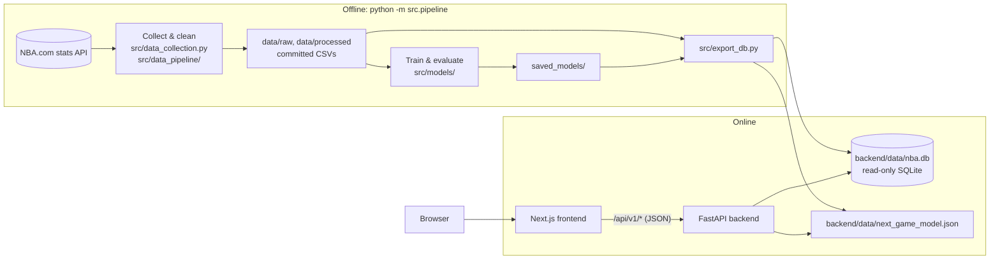

# Architecture

NBA Analytics is moving from a single Streamlit app (v1) to a full-stack application (v2): an offline data pipeline, a read-only REST API, and a web frontend. This document describes the target design, the data model, and the reasoning behind the main decisions.

## Overview



| Layer | Technology | Responsibility |
| :--- | :--- | :--- |
| Pipeline | Python, pandas, scikit-learn, XGBoost, `nba_api` | Fetch data, clean it, train and evaluate models, export serving artifacts |
| Serving data | SQLite (`nba.db`), JSON model file | Everything the API needs, precomputed |
| Backend | FastAPI, Pydantic | Typed, read-only JSON API; live next-game predictions |
| Frontend | Next.js, TypeScript, Tailwind CSS, shadcn/ui, ECharts | Pages and interactive charts; API types generated from the OpenAPI schema |

Hosting is deliberately undecided. Everything is configured through environment variables and runs in Docker, so the same build can move between hosts.

## Design principles

1. **Precompute everything that doesn't depend on user input.** MVP predictions, percentiles and similar players change only when the pipeline reruns, so they are computed once at build time instead of on every request.
2. **Keep training and serving dependencies separate.** pandas, scikit-learn and XGBoost run only offline. The API needs only FastAPI, Pydantic and Python's built-in `sqlite3`. The XGBoost model is exported as plain JSON trees and evaluated in pure Python, which keeps the deployed bundle small and starts quickly. A test checks the export matches XGBoost's predictions.
3. **Fail at build time, not at request time.** The database schema (`src/db_schema.sql`) declares primary keys, foreign keys and `CHECK` constraints. The export validates every foreign key and writes to a temporary file, so a broken build never replaces a working database.
4. **One contract between frontend and backend.** Pydantic schemas generate the OpenAPI document, and the frontend's TypeScript types are generated from it. A breaking API change shows up as a type error in CI.

## Data model

Built by `python -m src.export_db` (about 12 MB). Columns ending in `_pg` are per-game averages; `*_pct` columns are fractions.

| Table | Rows (approx.) | Contents |
| :--- | ---: | :--- |
| `franchises` | 30 | Current team abbreviation, NBA team ID (for logos), name, conference, brand colors |
| `players` | 2,000 | Name, search key (lowercase, no accents), official listed position and G/F/C group, height, weight, country, college, draft details |
| `seasons` | 26 | 2000-01 to 2025-26, with champion and MVP |
| `team_seasons` | 776 | Record, win %, point differential, conference rank, championship flag |
| `player_seasons` | 10,600 | Per-game and advanced stats, archetype, tier and archetype scores |
| `player_percentiles` | 21,000 | Percentile of each stat among all players and within the player's position group, per season |
| `similar_players` | 37,000 | Five most similar player-seasons (same season) by archetype-score distance |
| `mvp_candidates` | 285 | Leave-one-season-out model score and rank for every MVP candidate |
| `mvp_seasons` | 26 | Predicted vs actual MVP per season, era, where the real MVP ranked |
| `team_game_log` | 14,500 | Each team's game-by-game results and running record (2020-21 onward) |
| `meta` | — | Build time, season range, headline model metrics |

Relocated teams (for example the Seattle SuperSonics) are stored under their current franchise (`OKC`), with the abbreviation of the time kept in `team_abbr_then`.

## Backend API

The API lives in `backend/`. Interactive documentation is served at `/docs`, and the full schema is committed as [`backend/openapi.json`](../backend/openapi.json). Every endpoint is a read-only `GET` except the prediction.

| Endpoint | Purpose |
| :--- | :--- |
| `GET /api/v1/meta` | Season range, build time and headline model metrics |
| `GET /api/v1/seasons` | Every season with its champion and MVP |
| `GET /api/v1/health` | Health check (database schema version, build time) |
| `GET /api/v1/players?q=&position_group=&season=&team=&limit=&offset=` | Paginated player search; ignores accents and case |
| `GET /api/v1/players/{id}` | Profile: bio, career averages, season-by-season stats, MVP seasons |
| `GET /api/v1/players/{id}/similar?season=` | Five most similar players in a season |
| `GET /api/v1/players/compare?ids=&ids=&season=&peer_group=ALL\|POSITION` | Stats and percentiles for 2 to 4 players |
| `GET /api/v1/mvp` | Model accuracy overall, by era and per season |
| `GET /api/v1/mvp/{season}?limit=` | MVP race: ranked candidates with scores and stats |
| `GET /api/v1/teams` | All 30 franchises with their latest record |
| `GET /api/v1/teams/{abbr}` | Franchise history and championships |
| `GET /api/v1/teams/{abbr}/roster?season=` | Players on a team in a season |
| `GET /api/v1/teams/{abbr}/form?season=` | Game-by-game record and running win % (2020-21 onward) |
| `POST /api/v1/games/predict` | Home win probability; omitted win % inputs default to the latest season's records |

### Code layout

```
backend/app/
├── main.py          # App factory: lifespan checks, CORS, cache headers, routers
├── config.py        # Settings from environment variables
├── db.py            # Read-only SQLite connection per request, schema version check
├── routers/         # HTTP layer: parameters, validation, status codes
├── services/        # Logic beyond a query: player comparison, game prediction, tree model
├── repositories/    # Parameterized SQL, returns plain dicts
└── schemas/         # Pydantic response and request models (generate the OpenAPI schema)
```

### Behaviour

- **Startup checks.** The app refuses to start if the database is missing or was built with a different schema version, or if the model file can't be loaded.
- **Read-only access.** Each request opens the database with `mode=ro&immutable=1`, so the API can never write to it, and SQLite skips locking.
- **Caching.** Successful `GET` responses send `Cache-Control: public, max-age=…` because the data changes only when the pipeline reruns. Errors, predictions and the health check send `no-store`.
- **Errors.** Unknown resources return `404` with `{"detail": "..."}`; invalid input returns FastAPI's standard `422` body.

### Configuration

| Variable | Default | Purpose |
| :--- | :--- | :--- |
| `NBA_DB_PATH` | `backend/data/nba.db` | Serving database |
| `NBA_MODEL_PATH` | `backend/data/next_game_model.json` | Exported next-game model |
| `NBA_ALLOWED_ORIGINS` | `http://localhost:3000` | Comma-separated CORS origins (the frontend) |
| `NBA_CACHE_MAX_AGE` | `3600` | Seconds clients may cache `GET` responses |
| `PORT` | `8000` | Port inside the Docker image |

### Docker

`backend/Dockerfile` has two stages. The first installs the pipeline requirements and runs `python -m src.export_db` on the committed data. The second starts from a clean `python:3.11-slim`, installs only FastAPI, Pydantic and Uvicorn, and copies in the app and the built database. Training libraries never reach the runtime image. The container runs as a non-root user and has a health check.

## Testing and CI

- **Pipeline:** unit tests for helpers, integrity checks on the committed datasets, model regression guards (MVP accuracy, tier ordering, no look-ahead in game features).
- **Export:** builds the database in a temp folder and checks foreign keys, MVP consistency, percentile bounds, game-log records against standings, and exported-model parity with XGBoost.
- **Backend:** endpoint tests with FastAPI's `TestClient` against the real database, covering:
  - search relevance, accent handling and pagination
  - 404 and 422 cases
  - prediction validation
  - cache and CORS headers
  - unit tests for the tree evaluator, and parity with XGBoost
  - a snapshot test that fails if the API schema changes without `backend/openapi.json` being regenerated
- **Frontend (planned):** type checking, linting, component tests (Vitest), end-to-end tests (Playwright) against the full stack in Docker Compose.

GitHub Actions runs three jobs on every push to `main` and every pull request:
1. pipeline tests
2. API lint (ruff) and tests, after building the database
3. a Docker build with a health-check smoke test

## Roadmap

| Phase | Scope | Status |
| :--- | :--- | :--- |
| 0. Foundations | Serving database export, official player bio data, this document | Done |
| 1. Backend API | FastAPI app, endpoints above, tests, Dockerfile | Done |
| 2. Frontend foundation | Next.js app, design system, typed API client, MVP Race page | Next |
| 3. Core pages | Home, player search/profile/compare, game predictor, franchise pages | Planned |
| 4. Ship | Hosting, end-to-end tests, README with screenshots; retire the Streamlit app | Planned |
| 5. Extensions | Archetype and All-Star pages, Basketball Reference data (MVP vote shares, real All-Star rosters) | Later |
