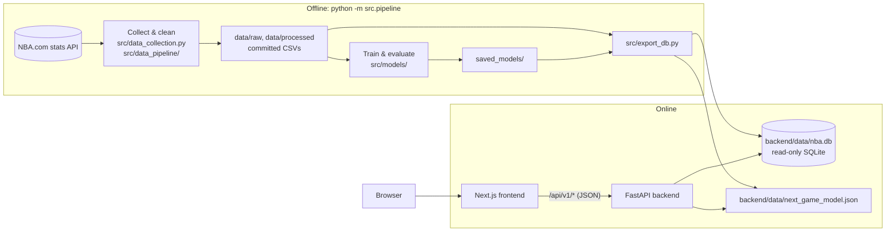

# Architecture

NBA Analytics is moving from a single Streamlit app (v1) to a full-stack application (v2): an offline data pipeline, a read-only REST API, and a web frontend. This document describes the target design, the data model, and the reasoning behind the main decisions.

## Overview

| Layer | Technology | Responsibility |
| :--- | :--- | :--- |
| Pipeline | Python, pandas, scikit-learn, XGBoost, `nba_api` | Fetch data, clean it, train and evaluate models, export serving artifacts |
| Serving data | SQLite (`nba.db`), JSON model file | Everything the API needs, precomputed |
| Backend | FastAPI, Pydantic | Typed, read-only JSON API; live next-game predictions |
| Frontend | Next.js, TypeScript, Tailwind CSS, shadcn/ui, ECharts | Pages and interactive charts; API types generated from the OpenAPI schema |

Hosting is deliberately undecided. Everything is configured through environment variables and runs in Docker, so the same build can move between hosts.

## Design principles

1. **Precompute everything that doesn't depend on user input.** MVP predictions, percentiles and similar players change only when the pipeline reruns, so they are computed once at build time instead of on every request.
2. **Keep training and serving dependencies separate.** pandas, scikit-learn and XGBoost run only offline. The API needs only FastAPI, Pydantic and Python's built-in `sqlite3`. The XGBoost model is exported as plain JSON trees and evaluated in pure Python, which keeps the deployed bundle small and starts quickly. A test checks the export matches XGBoost's predictions.
3. **Fail at build time, not at request time.** The database schema (`src/db_schema.sql`) declares primary keys, foreign keys and `CHECK` constraints. The export validates every foreign key and writes to a temporary file, so a broken build never replaces a working database.
4. **One contract between frontend and backend.** Pydantic schemas generate the OpenAPI document, and the frontend's TypeScript types are generated from it. A breaking API change shows up as a type error in CI.

## Data model

Built by `python -m src.export_db` (about 12 MB). Columns ending in `_pg` are per-game averages; `*_pct` columns are fractions.

| Table | Rows (approx.) | Contents |
| :--- | ---: | :--- |
| `franchises` | 30 | Current team abbreviation, NBA team ID (for logos), name, conference, brand colors |
| `players` | 2,000 | Name, search key (lowercase, no accents), official listed position and G/F/C group, height, weight, country, college, draft details |
| `seasons` | 26 | 2000-01 to 2025-26, with champion and MVP |
| `team_seasons` | 776 | Record, win %, point differential, conference rank, championship flag |
| `player_seasons` | 10,600 | Per-game and advanced stats, archetype, tier and archetype scores |
| `player_percentiles` | 21,000 | Percentile of each stat among all players and within the player's position group, per season |
| `similar_players` | 37,000 | Five most similar player-seasons (same season) by archetype-score distance |
| `mvp_candidates` | 285 | Leave-one-season-out model score and rank for every MVP candidate |
| `mvp_seasons` | 26 | Predicted vs actual MVP per season, era, where the real MVP ranked |
| `team_game_log` | 14,500 | Each team's game-by-game results and running record (2020-21 onward) |
| `meta` | — | Build time, season range, headline model metrics |

Relocated teams (for example the Seattle SuperSonics) are stored under their current franchise (`OKC`), with the abbreviation of the time kept in `team_abbr_then`.

## Backend API (planned)

All endpoints are read-only `GET` requests except the prediction.

| Endpoint | Purpose |
| :--- | :--- |
| `GET /api/v1/meta/seasons` | Season list and headline metrics |
| `GET /api/v1/players?search=` | Player search |
| `GET /api/v1/players/{id}` | Profile with season-by-season stats |
| `GET /api/v1/players/{id}/similar?season=` | Similar players |
| `GET /api/v1/players/compare?ids=&season=&group=` | Percentile comparison |
| `GET /api/v1/mvp/accuracy` | Model results for all seasons |
| `GET /api/v1/mvp/{season}` | MVP race for one season |
| `GET /api/v1/teams`, `GET /api/v1/teams/{abbr}` | Franchise list and history |
| `GET /api/v1/teams/{abbr}/form` | Current record and win % trend |
| `POST /api/v1/games/predict` | Next-game win probability |
| `GET /api/v1/health` | Health check |

## Testing and CI

- **Pipeline:** unit tests for helpers, integrity checks on the committed datasets, model regression guards (MVP accuracy, tier ordering, no look-ahead in game features).
- **Export:** builds the database in a temp folder and checks foreign keys, MVP consistency, percentile bounds, game-log records against standings, and exported-model parity with XGBoost.
- **Backend (planned):** endpoint tests with FastAPI's `TestClient`.
- **Frontend (planned):** type checking, linting, component tests (Vitest), end-to-end tests (Playwright) against the full stack in Docker Compose.

GitHub Actions runs the suite on every push to `main` and every pull request.

## Roadmap

| Phase | Scope | Status |
| :--- | :--- | :--- |
| 0. Foundations | Serving database export, official player bio data, this document | Done |
| 1. Backend API | FastAPI app, endpoints above, tests, Dockerfile | Next |
| 2. Frontend foundation | Next.js app, design system, typed API client, MVP Race page | Planned |
| 3. Core pages | Home, player search/profile/compare, game predictor, franchise pages | Planned |
| 4. Ship | Hosting, end-to-end tests, README with screenshots; retire the Streamlit app | Planned |
| 5. Extensions | Archetype and All-Star pages, Basketball Reference data (MVP vote shares, real All-Star rosters) | Later |
